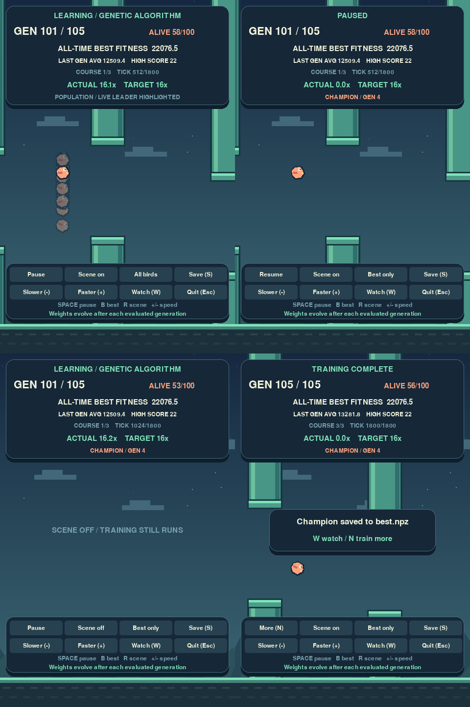

# Phase 4 — Visualize AI Learning

Start the dashboard with the existing trained population:

```powershell
.\.venv\Scripts\python.exe main.py --train --resume models/checkpoint.npz --generations 50 --train-speed 16
```

For a fresh population, omit `--resume`. Use `--output-dir another-run` to keep
the existing training artifacts. Training evaluates all birds on each configured
course before selecting parents, crossing their weights and mutating offspring.
Multiple translucent birds share the visible course; each has independent
physics, neural decisions and collision state. The highlighted bird is opaque.



## Read the dashboard

| Display | Meaning |
| --- | --- |
| Generation / target | The generation being evaluated, or the last completed generation after finishing |
| Alive | Surviving birds on the displayed course; reaching the tick cap can leave survivors |
| All-time best fitness | Best completed network, averaged over every training course |
| Last gen average | Population average from the last fully evaluated generation; `--` before the first completes |
| High score | Highest pipe score seen in completed generations or the current course |
| Course / tick | Current course number and actual simulation progress towards its tick cap |
| Actual / target speed | Measured simulated seconds per wall-clock second, and the requested multiplier |

Measured speed samples every half second and includes rendering, display pacing
and checkpoint work. It counts shared-course ticks once, regardless of population
size. The 12 ms work budget per displayed frame can limit speed below the target.
Physics uses the same fixed timestep at every speed. Pause and completion display
zero current speed. Turning the scene off skips birds and pipes while training
and the dashboard continue.

## Controls

| Action | Keyboard / clickable button |
| --- | --- |
| Pause or resume | Space / Pause or Resume |
| Change target speed (1–128x) | +/- / Slower or Faster |
| Toggle scene rendering | R / Scene on or off |
| Show champion or whole population | B / All birds or Best only |
| Save checkpoint and available champion | S / Save |
| Watch the saved champion alone | W / Watch; available after the first evaluated generation |
| Add another block of generations after completion | N / More |
| Save and exit | Esc / Quit, or close the window |

“Best only” finds the exact saved champion's weights in the displayed episode.
It does not silently replace a dead champion with a surviving bird. Its last
position remains visible with an “out this course” label while the other birds
finish evaluating. Before a champion exists, this view explicitly shows the live
leader, selected using the configured fitness rewards. If a supplied population
does not contain the saved champion, the dashboard says so and offers W playback.
Changing view never removes birds from evaluation.

Completed-course views retain the genomes that actually produced their results,
even though the trainer has already bred the next generation. Champion saving
uses the best fully evaluated network, rather than the current unranked leader.

## Champion playback and return

```powershell
.\.venv\Scripts\python.exe main.py --watch --seed 42
.\.venv\Scripts\python.exe main.py --watch another-run/best.npz
```

`--watch` defaults to `models/best.npz` and starts flying immediately. The
existing `--model PATH` mode still opens the normal menu. Both use the same
controller and automatically restart after a loss unless `--no-auto-restart`
is supplied. Watch mode applies fixed weights; it does not train them.

W from the dashboard freezes training and starts champion playback. T in that
playback returns to the same in-memory trainer and dashboard: population, RNG,
partially evaluated course, tick, generation target and control preferences stay
intact. At completion, N explicitly extends the target. Closing playback exits
the training session. Checkpoints remain generation-boundary snapshots: after a
process restart, a partial generation is replayed from its beginning.

## Agent information

Rendering and statistics are observers. Every network still receives only the
five normalized features: bird height, vertical velocity, horizontal distance
to the next pipe, and vertical distances to that pipe's gap edges. The controller
uses the manual 5 → 8 → 1 network and flaps only when its output exceeds 0.5.
Generation, seed, score, fitness, other birds and future pipes are never neural
inputs. A course seed controls reproducibility, not the bird's decisions.

## Verification

```powershell
.\.venv\Scripts\python.exe -m unittest discover -v
```

Checks cover real evolution, pause, mouse and keyboard controls, rendering without
training changes, champion identity after death and breeding, measured speed at
custom physics FPS, live playback return, CLI watch and persistence. The UI checks
render through SDL's offscreen driver. Phase 5's optional analytics graphs are
the next stage.
